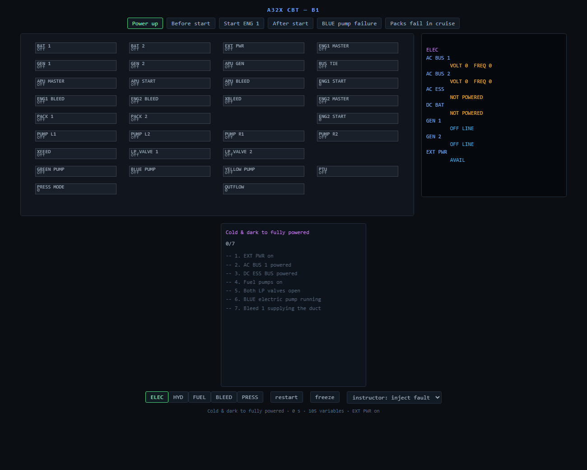

# A32X CBT

A trainer for the A320's fly-by-wire, built to run on a laptop with no graphics card and no installer.
It has two parts:

- **A flight simulator** (`flight/`, GPLv3). The real FlyByWire A32NX flight-control computers — two
  ELACs, three SECs, two FACs, two FCDCs — run at 50 Hz and fly a JSBSim airframe of ours, fitted to
  57 cited A320 targets. It flies in the browser, straight from `file://`, with a joystick or the
  keyboard, starting at Dallas Fort Worth (KDFW). It also flies headless, which is how it is tested.
- **A systems trainer** (`app/`, MIT): systems, ECAM, flows and graded drills.



Unofficial. "Airbus", "A320" and "A32NX" belong to their owners. Not affiliated with Airbus, FlyByWire
Simulations or Aerowinx, and not suitable for type training.

## Where it stands

The flight simulator is the product now, and it is mid-build (`ROADMAP.md`, P7):

- The A32NX computers fly our A320 from takeoff to landing in normal law, and run for 30 minutes at
  50 Hz with no NaN or infinity on any output (the P6 gate).
- The airframe is inside all 57 of its targets: stall speeds and alphas by configuration, approach
  attitudes, the drag rise, roll and damping, and its engines' thrust against the type certificate and
  the public ANP noise-and-performance database, whose A320 entry Airbus developed. Public numbers,
  not Airbus's flight-test data. `flight/README.md` has every row, its source, and the fit.
- In the browser: the flight core as WebAssembly, a joystick mapped from the pilot's own hands, a view
  of KDFW drawn as a 1980s full-flight simulator drew it, real runways with an ILS, wind and
  turbulence.
- Next: failures that reach every law, the protections driven and held, then the gate — five
  hand-flown ILS approaches, stable and repeatable. After that the cockpit displays (P8) and the FMS
  (P9).

## Run it

**The systems trainer.** No Node needed: open `app/web/index.html` — double-click it. The page is one
committed script with its content inlined, so it works straight off the disk. To rebuild or develop:

```
cd app
npm ci
npm run build:web
npm run check      # typecheck + 182 tests
```

**The flight simulator** is not packaged for download yet (*Releases*, below). It builds with CMake
against two clones kept outside this repository, A32NX and JSBSim at pinned commits; the browser
build adds Emscripten 6.0.12 and Node. `flight/README.md` has the recipes: *Build and run*, *The
browser simulator* and *Getting the sources*. Native, in short:

```
cmake -S flight -B flight/build -DA32NX_DIR=<A32NX clone> -DJSBSIM_DIR=<JSBSim clone>
cmake --build flight/build --config Release
ctest --test-dir flight/build -C Release --output-on-failure
```

## Releases

Two artefacts, as `ROADMAP.md` sets them (*Decisions*, packaging):

- **`a32x-cbt.zip`**: the systems trainer alone, MIT. `npm run package` in `app/` builds it and
  `npm run gate` checks it.
- **The flight simulator**: one GPLv3 artefact, the browser build carrying the trainer, released with
  its Corresponding Source — our source and build scripts, the exact A32NX and JSBSim sources compiled
  into it, and every licence and notice. Not released yet.

Neither needs an installer. Unzip, then open its `index.html`. Tested in Chrome and Edge on Windows;
other browsers and systems have not been tried.

## Layout

| path | what |
|---|---|
| `app/` | the systems trainer — systems, panel, ECAM, procedures. MIT. |
| `flight/` | the flight simulator: the A32NX computers flying a JSBSim airframe, the browser shell (`flight/web`), and the tools that score and fit the airframe. GPLv3. |
| `docs/` | provenance, architecture, and the design study of the PSX reference |
| `reference/` | screenshots |

## Licence and provenance

Everything outside `flight/` is MIT (`LICENSE`). `flight/` is GPLv3 (`flight/LICENSE`): it compiles
FlyByWire A32NX, GPLv3, and JSBSim, LGPL-2.1. MIT code may travel inside the GPLv3 simulator; nothing
from `flight/` goes into `app/`.

No third-party source is vendored. `app/` is original TypeScript; the behaviour in it was worked out
by study. `docs/provenance.md` names every source and the position taken on each.

## For an agent working here

Read `CLAUDE.md`, then `docs/provenance.md`, then `ROADMAP.md`. The suite must be green before any
commit.
