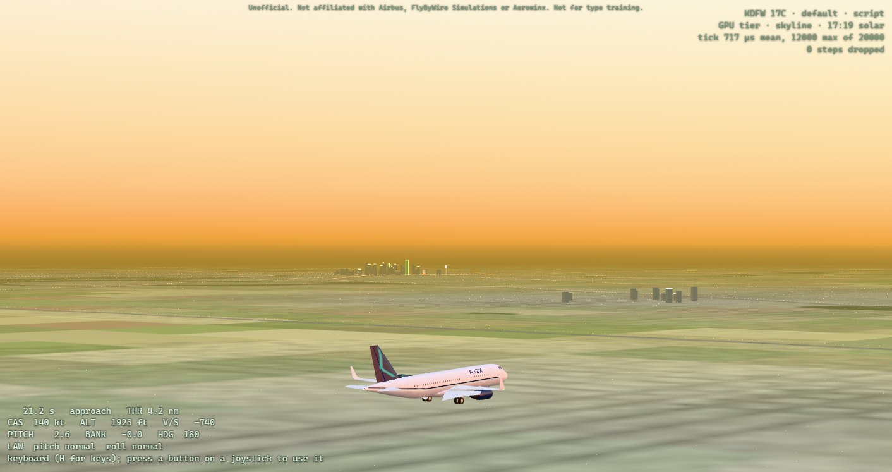
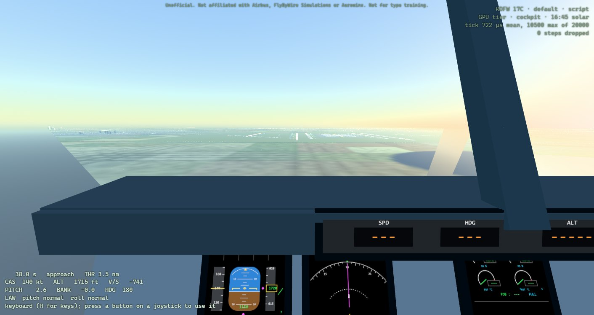
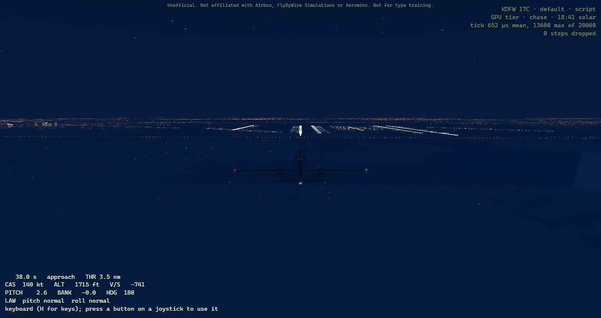
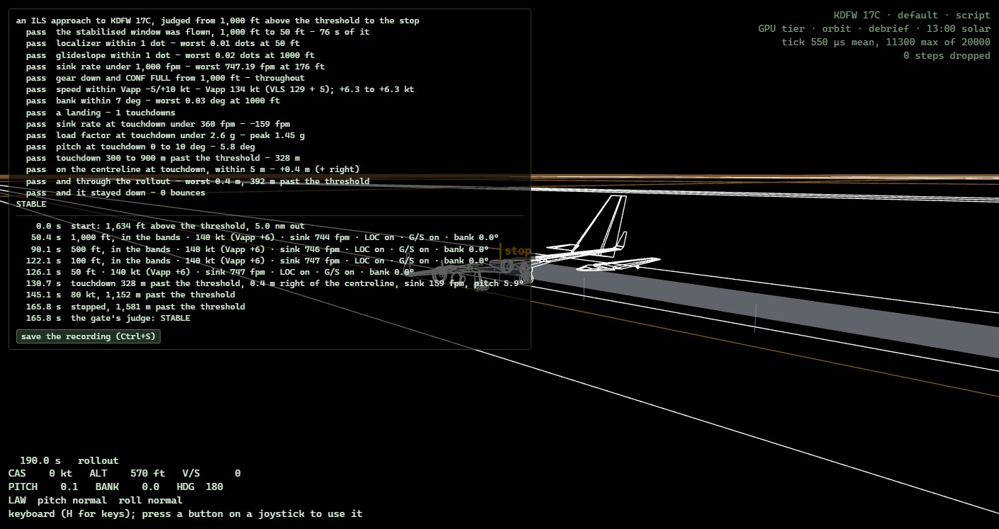

# A32X CBT



An A320 fly-by-wire trainer that runs on a laptop with no graphics card and no installer: FlyByWire's
real A32NX flight-control computers, hand-flown in the browser from Dallas Fort Worth.

**[Fly it in your browser](https://flightsim.bochen.xyz)** ·
**[Download for Windows](https://github.com/bochen2029-pixel/a32x-cbt/releases)** (unzip, double-click
`A32X.exe`) · **[The pilot's guide](docs/pilots-guide.md)**

It has two parts:

- **A flight simulator** (`flight/`, GPLv3). The real FlyByWire A32NX flight-control computers — two
  ELACs, three SECs, two FACs, two FCDCs — run at 50 Hz and fly a JSBSim airframe of ours, fitted to
  cited A320 data. It flies in the browser, straight from `file://`, with a joystick or the keyboard,
  starting at Dallas Fort Worth (KDFW). It also flies headless, which is how it is tested.
- **A systems trainer** (`app/`, MIT): systems, ECAM, flows and graded drills.

<table>
<tr>
<td width="50%"></td>
<td width="50%"></td>
</tr>
<tr>
<td>On the ILS from the flight deck. Its displays are stand-ins until P8 draws the real ones.</td>
<td>Night over Dallas: the approach lights and the touchdown zone of 17C ahead.</td>
</tr>
<tr>
<td></td>
<td></td>
</tr>
<tr>
<td>After the stop: the gate's judge, band by band, and the flight's moments, reversers included.</td>
<td>The systems trainer: the overhead switches, the ELEC page and a drill, cold and dark to powered.</td>
</tr>
</table>

Unofficial. "Airbus", "A320" and "A32NX" belong to their owners. Not affiliated with Airbus, FlyByWire
Simulations or Aerowinx, and not suitable for type training.

## Where it stands

The flight simulator is the product, at its sixth pre-release,
[0.1.5](https://github.com/bochen2029-pixel/a32x-cbt/releases/tag/v0.1.5) (`ROADMAP.md`, P7):

- The A32NX computers fly our A320 in normal, alternate and direct law. The instructor's failures take
  them there, and the scripted crew lands every degraded case but the double hydraulic losses. In the
  clean configuration the protections hold the A320's bank, load-factor and low-speed angle-of-attack
  limits.
- The airframe is fitted to cited data: stall speeds and alphas by configuration, approach attitudes,
  the drag rise, roll and damping, the stall and past it, the drag of the flaps and gear, and its
  engines' thrust and spool-up against the type certificate, the certification rules and the public
  ANP noise-and-performance database, whose A320 entry Airbus developed: inside 75 of its 76 targets,
  the one outside a held-out check of the pitching moment deep past the stall, an open finding.
  Public numbers, not Airbus's flight-test data. `flight/README.md` has every row, its source, and the
  fit.
- In the browser: the flight core as WebAssembly, a joystick mapped from the pilot's own hands, KDFW
  and Dallas drawn as a 1980s full-flight simulator drew them (a GPU tier over a floor that runs on
  software rendering), an ILS on every runway, wind and turbulence, ground idle and reverse thrust.
- The gate's judge scores a hand-flown ILS against stabilised-approach bands, from 1,000 ft to the
  stop; a saved recording names the build that flew it and replays natively to the same verdict. The
  debrief plays the flight back on a timeline, in the manner of Tacview, and a saved recording opens in
  the page (Ctrl+O) and flies again through the core, its verdict set against the one it was saved with.
- Left in P7: the gate itself, five hand-flown approaches, stable and repeatable. Known open: a fast,
  full back-stick pull with full flaps can stall it, A32NX's protection acting on a lagged alpha
  (asked upstream as
  [flybywiresim/aircraft discussion #11009](https://github.com/flybywiresim/aircraft/discussions/11009)).
  After the gate, the cockpit displays (P8) and the FMS (P9).

## Run it

**The systems trainer.** No Node needed: open `app/web/index.html` — double-click it. The page is one
committed script with its content inlined, so it works straight off the disk. To rebuild or develop:

```
cd app
npm ci
npm run build:web
npm run check      # typecheck + 182 tests
```

**The flight simulator.** Nothing to build: fly it at [flightsim.bochen.xyz](https://flightsim.bochen.xyz),
or take the Windows zip from [Releases](https://github.com/bochen2029-pixel/a32x-cbt/releases), unzip it
and double-click `A32X.exe` (Windows SmartScreen warns on the unsigned launcher: More info, Run anyway).
The [pilot's guide](docs/pilots-guide.md) says how to fly it. To build it yourself: CMake against two
clones kept outside this repository, A32NX and JSBSim at pinned commits; the browser build adds
Emscripten 6.0.12 and Node. `flight/README.md` has the recipes: *Build and run*, *The browser
simulator* and *Getting the sources*. Native, in short:

```
cmake -S flight -B flight/build -DA32NX_DIR=<A32NX clone> -DJSBSIM_DIR=<JSBSim clone>
cmake --build flight/build --config Release
ctest --test-dir flight/build -C Release --output-on-failure
```

## Releases

Two artefacts, as `ROADMAP.md` sets them (*Decisions*, packaging):

- **`a32x-cbt.zip`**: the systems trainer alone, MIT. `npm run package` in `app/` builds it and
  `npm run gate` checks it.
- **`a32x-sim-0.1.5-win64.zip`**: the flight simulator for Windows, GPLv3. `A32X.exe`, a launcher of
  ours, opens the page beside it in Microsoft Edge as an app window, or in the default browser; the
  trainer rides along under its own MIT notice, with every licence and notice. Beside it,
  **`a32x-sim-0.1.5-source.zip`**, its Corresponding Source: this repository at the commit and the
  exact A32NX and JSBSim sources compiled into it, with Emscripten 6.0.12 named. `npm run release` in
  `flight/web` builds both, the first from the second, and `npm run release:gate` checks them
  (`flight/README.md`, *The Windows release*). Published on GitHub as pre-releases, each with its
  source zip and `SHA256SUMS`; from 0.1.1 the pilot's guide comes beside them as a PDF.

Neither needs an installer. Unzip, then open the trainer's `index.html`, or run the simulator's
`A32X.exe`. Tested in Chrome and Edge on Windows; other browsers and systems have not been tried.

## Layout

| path | what |
|---|---|
| `app/` | the systems trainer — systems, panel, ECAM, procedures. MIT. |
| `flight/` | the flight simulator: the A32NX computers flying a JSBSim airframe, the browser shell (`flight/web`), and the tools that score and fit the airframe. GPLv3. |
| `docs/` | the pilot's guide (and its pictures), provenance, architecture, and the design study of the PSX reference |
| `reference/` | screenshots |

## Licence and provenance

Everything outside `flight/` is MIT (`LICENSE`). `flight/` is GPLv3 (`flight/LICENSE`): it compiles
FlyByWire A32NX, GPLv3, and JSBSim, LGPL-2.1. MIT code may travel inside the GPLv3 simulator; nothing
from `flight/` goes into `app/`.

No third-party source is vendored. `app/` is original TypeScript; the behaviour in it was worked out
by study. `docs/provenance.md` names every source and the position taken on each.

## For an agent working here

Read `CLAUDE.md`, then `docs/provenance.md`, then `ROADMAP.md`. The suite must be green before any
commit.
