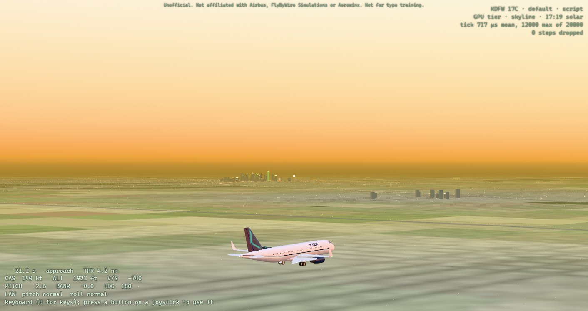
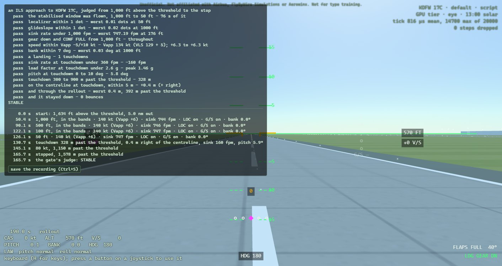

# What it is

The A32X flies an Airbus A320 in a web page. Its flight controls are FlyByWire's A32NX flight-control
computers — the A320's pitch and roll laws, built from the A32NX's own source — on a JSBSim airframe
fitted to the A320's published performance. The flight runs at fifty steps a second in the page's
background worker, from a folder on your disk: no server, no network, nothing to install.

The view outside is drawn as a full-flight simulator of the 1980s drew it — light points, flat-shaded
polygons, a horizon in haze — at Dallas/Fort Worth International, KDFW, on runway 17C.

Today the simulator is for one thing above all: flying an ILS approach by hand, and being judged on it
(the *P7 gate*, below). There is no autopilot, no autothrust and no FMS yet, and the flight deck's
screens are placeholders until the next phase draws the real ones.

> This is an unofficial training aid, not affiliated with Airbus, FlyByWire Simulations or Aerowinx,
> and not suitable for type training. Nothing in it is fit for navigation.

# Getting it running

Open `index.html` from the page's folder in Chrome or Edge: `flight/build-web/` when you build it
yourself, or the release's own folder. The page loads the flight core, draws the airport, and starts
the flight. Its top-right corner says which airport and runway it drew, which airframe is flying, who
is flying it, and which build of the simulator this is, the commit it was made from (a build made from
uncommitted changes, `+dirty`, is marked in amber: the gate does not take it); under that, how it
draws, and how much each step of the flight costs.

To build it, `flight/README.md` ("The browser simulator") has the steps: the flight core through
Emscripten, then `node tools/build.mjs --core <flight_core.js>` in `flight/web`.

**Two tiers.** The page chooses how to draw from what draws it:

- **With a graphics card**, the *GPU tier*: the sky computed for any hour of 1 November, haze over
  everything, the country round DFW — its lakes, the Trinity, the towns' lights — and the Dallas
  skyline, Reunion Tower among it.
- **Without one**, when the computer draws every pixel itself (Windows' WARP, or SwiftShader), the
  *floor tier*: the same airport, plainer, so the flight keeps its fifty steps a second.

`tier=low` or `tier=high` in the address forces either.

# Your first flight: watch the crew

Open the page with `?crew=script&scenario=approach` after `index.html`. The scripted crew flies the ILS
to 17C from 10 nm, lands and stops; you watch. Change the camera with the number keys, and at the stop
the verdict appears.

Then fly it yourself: the same address without `crew=script`. You start on the same approach, trimmed,
flaps FULL and gear down.

# The controls

## A joystick

Plug it in and press any button: the page reads it through the browser's Gamepad API. A standard
gamepad flies as it is. For any other device press **M**: the page asks for each control in turn —
move it, **Enter** confirms, **Escape** skips. Then **C** to calibrate: move every control to both its
ends, and press **C** again. The mapping and the calibration are kept for that device, in that browser.
Reverse thrust is a held button: D-pad up on a standard gamepad, or the one you choose in the mapping.

## The keyboard

| key | does |
|-------|---------------------------|
| ↑ ↓ ← → | the sidestick: ↓ pulls, ↑ pushes, ← → roll; it springs back when you let go |
| Z  X | rudder, left and right |
| PgUp  PgDn | thrust levers forward and back, with detents at CL, FLX/MCT and TOGA |
| Shift + PgDn | reverse thrust, on the ground: with Shift held the levers go back past idle, clicking at reverse idle and at MAX REV; coming forward they stop at idle |
| R  F | flaps, up and down a notch |
| G | gear, up or down |
| B | brakes, while held |
| P | parking brake |
| S | speedbrake |
| A | ground spoilers, armed |
| T  Y  U | rudder trim left, right, and reset |
| Home  End | pitch trim wheel, nose down and nose up |
| M  C | map a joystick; calibrate it |
| H | these keys, on the screen |

## The view

| key or mouse | does |
|---------|-------------------------|
| 1 to 9, 0 | cameras: **1** the pilot's eye, **2** the flight deck, **3** chase, **4** orbit, **5** tower, **6** flyby, **7** cabin, **8** skyline, **9** side, **0** satellite |
| V | the next camera |
| [  ] | the hour back and on, a quarter of an hour a press (GPU tier) |
| K | the debrief, on and off |
| L | the flown path, in the normal view |
| Ctrl+S | save the flight's recording |
| drag | look round the flight deck (2); swing round the aircraft (4, and the debrief) |
| wheel | zoom; in the orbit camera, closer and further |
| double click | the head and the zoom set back |

The pilot's eye (1) is the airframe's own eye point, and it is the only view with the overlay: the
overlay's horizon and pitch ladder are drawn for exactly that eye.

# Flying the ILS to 17C

The approach start puts you 10 nm out on runway 17C's ILS, at 140 kt, in the landing configuration —
flaps FULL, gear down — and trimmed. The glide is 3°: about 318 ft a nautical mile, 3,200 ft above the
threshold at 10 nm.

**Hands off, it holds.** In normal law the sidestick asks for a change, not a position: let go and the
aircraft holds its flight path, and its bank up to 33° (beyond that, let go and it rolls back toward
33°). Fly the ILS with small, brief inputs, then let go and watch the flight path symbol settle.

**The beams.** The magenta diamonds show where each beam lies from you: the localizer's below, the
glideslope's on the right. Fly *towards* the diamond to centre it. Two dots is full scale; the gate
allows one.

**The speed.** There is no autothrust: you hold the speed with the thrust levers (PgUp, PgDn). The
target, *Vapp*, appears in magenta under the speed about 24 s after the start: the FAC's lowest
selectable speed (VLS) plus 5 kt. From the normal 10 nm start it is fixed at 134 kt as you pass
1,000 ft above the threshold. Hold it between 5 kt below and 10 kt above.

**The landing.** The radio height, in the middle, turns amber below 400 ft. From about 30 ft begin a
gentle, growing pull, and at 20 ft close the thrust levers (where the real A320 calls RETARD). The
scripted crew flares that way and touches down at about 160 fpm, the nose 5.8° up, 330 m past the
threshold. Keep straight on the centreline with the rudder; on the ground, Shift + PgDn pulls the
levers into reverse thrust, and the brakes stop you. REV shows at the overlay's bottom right and in each
N1 dial on the flight deck's engine display, as the A320's does: amber while a reverser's doors move,
green once they are open; outside, the four doors on each engine's cowl swing out. While a reverser's
doors move, either way, its engine holds idle, as the A320's FADEC does: push the levers forward while
the doors stow, about two seconds, and there is no thrust until they are in.

**Flare progressively.** A normal approach and flare reach about 8° of angle of attack, some 2° short
of where the protection begins. An abrupt pull to full back stick near the ground, in CONF FULL, can
take this A320 past its stall: its lift curve starts to round at about 14° and peaks near 18°, and a
fast full pull, tested from 8,000 ft, went past the peak. Flare with a steady, growing pull, never a
snatch of the stick.
(`flight/README.md`, "The protections", has the measurements.)

# How the gate judges an approach

Every approach is judged from 1,000 ft above the threshold to the stop, by the flight core's own
judge — the same code whether the flight is flown in the browser or replayed on the native build.

| measure | band | judged |
|--------------|---------------|-------------|
| localizer | within 1 dot | 1,000 ft to 50 ft |
| glideslope | within 1 dot | 1,000 ft to 50 ft |
| sink rate | under 1,000 fpm | 1,000 ft to 50 ft |
| configuration | gear down, flaps FULL | from 1,000 ft |
| speed | Vapp −5 / +10 kt | 1,000 ft to 50 ft |
| bank | within 7° | 1,000 ft to 50 ft |
| sink rate at touchdown | under 360 fpm | touchdown |
| load factor at touchdown | under 2.6 g | touchdown |
| pitch at touchdown | 0 to 10° | touchdown |
| touchdown point | 300 to 900 m past the threshold | touchdown |
| main gear from the centreline | within 5 m | touchdown and rollout |

An approach is **stable** when it never leaves a band between 1,000 ft and 50 ft and touches down
inside every touchdown band, without a bounce. The bands are the Flight Safety Foundation's
stabilised-approach criteria, Airbus's speed band and the A320's touchdown limits; `ROADMAP.md` says
which is whose.

**The P7 gate** is five consecutive approaches flown by hand — joystick, browser — each of them stable,
with their touchdown points within 150 m of their mean.

## The verdict, and the flight's moments

At the stop a panel opens on the left with the judge's verdict, a line a band: **pass**, **FAIL**, or
dots where it could not judge, each with its worst value and where it happened; then **STABLE**, or
**NOT STABLE** and how many bands broke.

Under it, the flight's moments in order, each with its simulated time: the start; each gate — 1,000,
500, 100 and 50 ft above the threshold — with the speed against Vapp, the sink, where you were on the
beams and the bank; every time you left the gate's bands and came back; the gear and the flight laws
when they change; the touchdown, a bounce, the reversers deployed and stowed, 80 kt and the stop, each
with how far past the threshold; and the verdict.

## The debrief

**K** turns the world to vectors on black, as an air-combat debrief does: the runways' outlines, the
ILS as a tunnel of one-dot boxes every half mile, the aircraft as a wire outline, and the path you
flew as a ribbon that keeps the wings' bank, **green** where you were inside the gate's bands, **red**
where you were outside them, **grey** outside the 1,000 ft to 50 ft window. The moments are tagged on
the path where they happened. Drag to swing round, the wheel to come closer. **L** draws the same path
in the normal view.

Along the debrief's foot runs a timeline: the flight as a bar, coloured as the path is, its moments
marked. Drag along it to go back through the flight: the aircraft is drawn in cyan where it was then,
the camera follows it, and the bar says where you were and how you stood, height, speed against Vapp,
sink, the beams and the bank. **,** and **.** step a second (with Shift, ten), **Space** plays it at the
flight's own pace, and clicking a moment in the panel, the touchdown say, takes you there. **LIVE**, at
the bar's right end, follows the flight again.

# Saving a flight, and handing it in

**Ctrl+S**, or the panel's button, saves the flight's recording to the browser's downloads, named for
what was flown:

    a32x-a320-approach-20261101T1744Z-0289s.csv

The name gives the airframe, the scenario, when it was flown (UTC, so that five approaches sort in
the order flown) and its length in simulated seconds. The file is the flight itself: the scenario and airframe it started
from, who flew it and with what, the build of the simulator that flew it (its `# build:` line: the
commit it was made from), the inputs of every one of its fifty steps a second, and at the end the
judge's verdict as it stood when you saved. You can save at any time; the recording runs from the start
to the moment you save.

The recording is what you hand in. The native build's judge, built from the same commit as the page
that flew it, replays it and must reach the same verdict:

    law_harness --replay a32x-a320-approach-20261101T1744Z-0289s.csv --expect ils

and the gate takes five of them at once:

    law_harness --repeatable a.csv b.csv c.csv d.csv e.csv

It replays each in a fresh process, judges it, and checks that all five are stable, hand-flown,
different flights, with their touchdowns within 150 m of their mean. Before that it checks the builds:
the five must come from one build, a commit's, and be judged with the `law_harness` built from that
same commit, or it refuses them and says why. A page built from changes no commit holds names itself
with `+dirty`, and one that cannot name its commit `unknown`; the gate takes neither, so fly the gate
on a release, or on a page built from a commit.

Five that passed count for a later release only if they still pass on it:

    law_harness --rejudge a.csv b.csv c.csv d.csv e.csv

built from that release, replays them there, judges them by every rule of the gate, and names every
band whose verdict differs from the one each recording was saved with. If any of the five is no longer
stable, they are flown again on the release.

# Starting elsewhere

Everything after `index.html?` in the address, joined with `&`:

| option | does |
|-------------|---------------|
| `scenario=approach` | the ILS to 17C from 10 nm; its options follow, joined with `;` |
| `…;distance=5` | from 5 nm instead (NM) |
| `…;loc=1;gs=0.5` | start off the beams: `loc=1` a dot left of the localizer, `gs=0.5` half a dot low; negative values, right and high |
| `…;cas=150` | at another speed (kt) |
| `…;wind=227/15` | a wind, from 227° at 15 kt; `turbulence=` a severity |
| `…;fail=green@420` | the instructor's failures, at a time in seconds: `adr1`–`3`, `ir1`–`3`, `green`, `blue`, `yellow`, `elac1`–`2`, `sec1`–`3`, joined with `+` to fail together, as in `fail=adr1+adr2+adr3@300,green@420` |
| `scenario=air;alt=10000;cas=250` | level and trimmed over the threshold, to try the protections: `alt` from 2,000 ft above the field to 39,000 ft, `cas` 100 to 400 kt, `lever=0..4` for the flaps; with `crew=script`, `manoeuvre=hold`, `bank`, `pull`, `push`, `alpha` or `speed` flies a protection as a test pilot would |
| `runway=LSZH14` | (in the scenario) Zurich's runway 14 instead of 17C |
| `airframe=737` | JSBSim's 737 flies instead of our A320 (it is still drawn as an A320) |
| `crew=script` | the scripted crew flies |
| `time=dawn`, `day`, `golden`, `dusk`, `night` | the hour; `hour=16.5` sets one (solar time, GPU tier) |
| `tier=low`, `tier=high` | the floor or the GPU tier |
| `cam=chase` | start in a camera (`eye`, `cockpit`, `chase`, `orbit`, `tower`, `flyby`, `cabin`, `skyline`, `side`, `satellite`) |
| `trail=1`, `debrief=1` | start with the path drawn, or in the debrief |
| `aa=0` | no antialiasing |

For example, `index.html?scenario=approach;distance=5;wind=200/12&time=night` is a five-mile approach
at night with a crosswind from the right.

# When something is wrong

**The status line says steps were dropped.** The flight could not keep up with real time for a moment
and skipped some steps, which it counts. A few at the start, or while the computer is busy with other
work, do no harm; many mean the computer is too slow for this tier: try `tier=low`.

**The joystick does nothing.** Press one of its buttons first: browsers hide a gamepad until it is
used. Then map it (M) and calibrate it (C).

**The page says the airport could not be drawn**, or another error in red at the top right: the page
stopped rather than fly in a broken world. The message says which file and which row.

**Nothing is kept between sessions.** A private window, or a browser that keeps nothing for pages
opened from disk, forgets the joystick's mapping each time; everything else works.

# Where it comes from

The flight-control laws are FlyByWire's A32NX (GPLv3); the flight model is JSBSim (LGPL-2.1); the
runways are OurAirports' and the terminals the FAA's airport diagram; the sky, the country, the city
and the A320's outline are this project's own, drawn by code when the page starts. `docs/provenance.md`
lists every source and what was taken from it.
